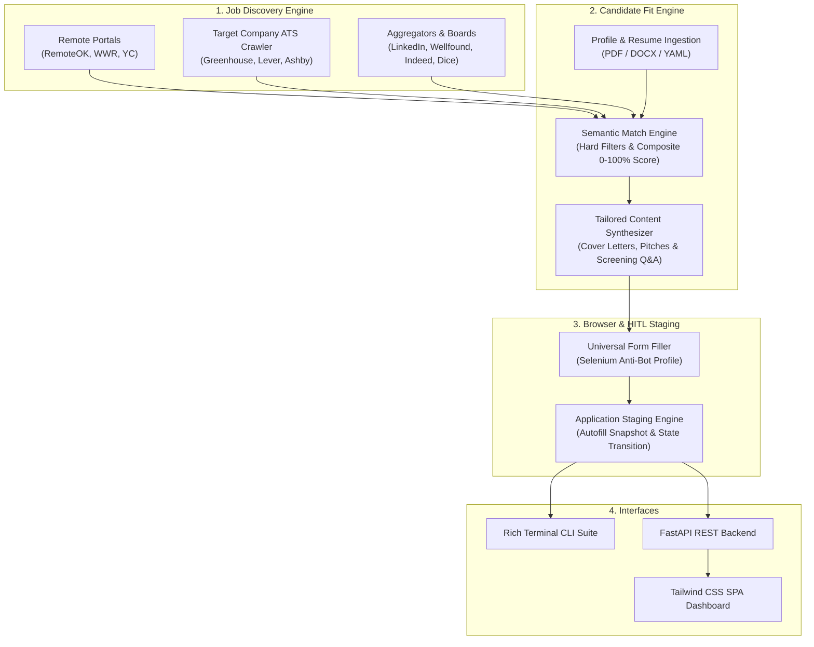

# Guffy: Autonomous Job Discovery & Tailored Application Engine

[](https://www.python.org/downloads/)
[](https://fastapi.tiangolo.com)
[](https://tailwindcss.com)
[](https://opensource.org/licenses/MIT)

**Guffy** is an intelligent, multi-portal job search aggregator, automated candidate match engine, and human-in-the-loop (HITL) application staging suite. It continuously discovers high-relevance tech roles across 8+ job boards, filters out unqualified positions via semantic heuristics, crafts tailored application assets (cover letters & startup pitch notes), autofills complex application portals, and provides a modern web dashboard and CLI to approve submissions with 1-click.

---

## Architecture Overview



---

## Key Features

- **Multi-Portal Discovery**: Automated scrapers and searchers for RemoteOK, WeWorkRemotely, Y Combinator ("Who is Hiring"), LinkedIn (Easy Apply), Wellfound / AngelList, Indeed, Dice, and Glassdoor.
- **Official Career Page Crawler**: Directly monitors dream target companies and extracts jobs from Greenhouse, Lever, Ashby, and bespoke company career portals with rate-limit handling and deduplication.
- **Semantic Fit Scoring**: Multi-stage match engine evaluating hard rule filters (title negatives, salary floor, company blacklists, remote requirement) and calculating composite fit scores (0–100%) with pros/cons rationale.
- **Content & Q&A Synthesizer**: Generates tailored cover letters aligning candidate background with job requirements, concise 3-sentence high-conversion startup pitches, and resolves screening questions (work authorization, sponsorship, notice period, compensation).
- **Universal Form Filler**: Selenium-based browser controller with anti-bot evasion techniques (realistic user agent, disabled automation flags, micro-randomized typing delays) and intelligent DOM input classification across 18+ common application field categories.
- **Human-in-the-Loop (HITL) Review Queue**: Applications are autofilled and snapshotted without auto-submitting. Review the populated form, inspection screenshots, and tailored pitch notes before 1-click execution.
- **FastAPI REST API & Tailwind SPA**: Full-featured interactive dashboard for tracking discoveries, filtering jobs, inspecting scores, managing companies, uploading resumes, and tracking the conversion funnel.
- **Rich CLI Suite**: Complete terminal interface with commands for initialization, crawling, scoring, reviewing, and dashboard serving.

---

## Installation & Setup

### 1. Clone & Set Up Python Environment

```bash
git clone https://github.com/your-username/Job-Hunt.git
cd Job-Hunt

# Create and activate virtual environment
python -m venv .venv
source .venv/bin/activate  # On Windows: .venv\Scripts\activate

# Install dependencies
pip install -r requirements.txt
# or install package in editable mode:
pip install -e .
```

### 2. Initialize Workspace & Database

Run the workspace initialization command to generate `config.yaml`, `profile.yaml`, and the SQLite database:

```bash
guffy init
```

### 3. Configure Your Candidate Profile

Edit `profile.yaml` to include your contact details, target titles, salary floor, skills, and screening answers:

```yaml
personal_info:
  full_name: "Alex Mercer"
  email: "alex@example.com"
  phone: "+1-555-0199"
  location: "Remote"
  linkedin_url: "https://linkedin.com/in/alexmercer"
  github_url: "https://github.com/alexmercer"

preferences:
  target_titles:
    - "Senior Backend Engineer"
    - "Python Engineer"
  remote_only: true
  min_base_salary_usd: 140000
  blacklisted_companies:
    - "BlacklistedCorp"

skills:
  languages: ["Python", "Go", "SQL"]
  frameworks: ["FastAPI", "Django", "React"]
  cloud_and_tools: ["Docker", "Kubernetes", "AWS", "PostgreSQL"]

screening_answers:
  work_authorization: "Yes"
  require_sponsorship: "No"
  notice_period: "2 weeks"
  expected_salary: "$150,000"
```

You can also upload a PDF or DOCX resume via the web dashboard or CLI to automatically parse and populate your skills catalog.

---

## CLI Usage Guide

Guffy includes a unified command-line interface:

### Commands Summary

| Command | Description | Example |
| :--- | :--- | :--- |
| `guffy init` | Provisions SQLite database and template configurations | `guffy init` |
| `guffy search` | Searches portals for live job postings | `guffy search -k "Python,Backend" -p "remoteok,wwr" --limit 25` |
| `guffy crawl-companies` | Crawls target company career pages & ATS APIs | `guffy crawl-companies --priority high -k "Engineer"` |
| `guffy match` | Runs semantic scoring against candidate profile | `guffy match --min-score 70` |
| `guffy review` | Interactive terminal review queue for staged jobs | `guffy review` |
| `guffy status` | Displays application pipeline conversion metrics | `guffy status` |
| `guffy serve` | Starts FastAPI backend & Tailwind SPA dashboard | `guffy serve --port 8000` |

### Detailed CLI Examples

#### Search Discovered Postings
```bash
# Search RemoteOK and WeWorkRemotely for remote Python roles and automatically score new jobs
guffy search -k "Python,FastAPI" -p "remoteok,wwr" --location "Remote" --auto-match
```

#### Crawl Target Company Career Boards
```bash
# Crawl all high-priority target companies listed in companies.yaml
guffy crawl-companies --priority high -k "Backend"
```

#### Review Staged Applications
```bash
# Launch interactive terminal review queue (actions: submit, skip, reject, quit)
guffy review
```

#### Start Web Dashboard
```bash
guffy serve --host 127.0.0.1 --port 8000
```
Then navigate to `http://127.0.0.1:8000/` in your browser.

---

## Web Dashboard UI

The Guffy Dashboard is a responsive Single-Page Application (SPA) built with Tailwind CSS.

- **Discovered Jobs**: Real-time filtering by status, portal, company substring, and minimum match score slider. Click on any job to view detailed skill overlap, missing skills, and pros/cons rationale.
- **HITL Review Queue**: Inspect autofilled forms, tailored cover letters, and generated pitch notes before triggering 1-click submission.
- **Target Companies**: Manage dream companies, view active job counts, and track crawl timestamps.
- **Profile & Resume Manager**: Update search preferences and screening questions, or upload a resume (`.pdf`, `.docx`) with instant skill extraction.
- **Pipeline Analytics**: Real-time visual conversion funnel and distribution breakdown across job portals.

---

## REST API Reference

The backend provides interactive OpenAPI documentation at `http://127.0.0.1:8000/docs`.

### Core Endpoints

- `GET /api/jobs`: Query and filter discovered job postings.
- `GET /api/jobs/{id}`: Inspect single job details with matched skills and staged application metadata.
- `POST /api/search`: Trigger multi-portal discovery search (supports background task execution).
- `POST /api/crawl-companies`: Crawl official target company career boards.
- `POST /api/match`: Run semantic scoring against candidate profile.
- `POST /api/stage/{id}`: Stage job application (autofills form and captures verification screenshot).
- `POST /api/approve/{id}`: Approve and finalize 1-click application submission.
- `GET /api/profile` & `PUT /api/profile`: Retrieve or update candidate profile configuration.
- `POST /api/profile/resume`: Upload resume file for automated skill parsing.
- `GET /api/companies`: List tracked target companies.
- `POST /api/companies`: Add a new target company to track.
- `DELETE /api/companies/{id}`: Remove a target company from tracking.
- `GET /api/analytics`: Retrieve conversion funnel counts, average match score, and portal distribution.

---

## Testing & Verification

Run the comprehensive test suite with `pytest`:

```bash
# Run all unit and integration tests
pytest

# Run End-to-End CLI & pipeline verification tests
pytest tests/test_e2e.py -v

# Run Web Dashboard SPA verification tests
pytest tests/test_dashboard.py -v
```

---

## Project Structure

```
Job-Hunt/
├── guffy/
│   ├── automation/          # Browser controller, form filler, & portal appliers
│   │   ├── browser.py
│   │   ├── form_filler.py
│   │   ├── ats_applier.py
│   │   ├── linkedin_applier.py
│   │   ├── wellfound_applier.py
│   │   ├── indeed_applier.py
│   │   └── staging_engine.py
│   ├── core/                # Database models, profile parser, match & generator engines
│   │   ├── database.py
│   │   ├── profile_manager.py
│   │   ├── matcher.py
│   │   └── generator.py
│   ├── searchers/           # Discovery portals & company ATS crawlers
│   │   ├── base.py
│   │   ├── remote_portals.py
│   │   ├── company_crawler.py
│   │   ├── linkedin.py
│   │   ├── wellfound.py
│   │   ├── indeed.py
│   │   └── glassdoor_dice.py
│   ├── web/                 # FastAPI backend & Tailwind SPA dashboard
│   │   ├── app.py
│   │   └── static/
│   │       ├── index.html
│   │       └── app.js
│   ├── cli.py               # Unified Rich terminal CLI suite
│   └── config.py            # Pydantic configuration loader
├── tests/                   # Comprehensive unit, integration, & E2E tests
│   ├── test_database.py
│   ├── test_profile_manager.py
│   ├── test_matcher.py
│   ├── test_generator.py
│   ├── test_remote_portals.py
│   ├── test_company_crawler.py
│   ├── test_searchers.py
│   ├── test_form_filler.py
│   ├── test_appliers.py
│   ├── test_api.py
│   ├── test_dashboard.py
│   └── test_e2e.py
├── companies.yaml           # Target dream companies list
├── profile.example.yaml     # Candidate profile template
├── pyproject.toml           # Project packaging & dependencies
└── README.md                # Comprehensive documentation
```

---

## License

This project is open-source under the [MIT License](LICENSE).
