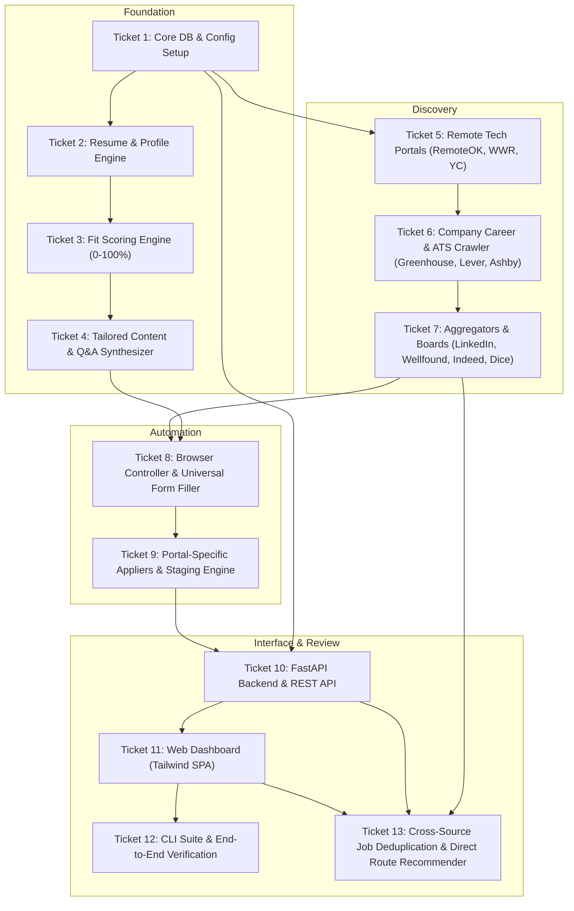

# Guffy: Modular Ticketed Implementation Plan

## Goal Description
Break down the complete **Guffy** architecture into 12 self-contained, sequentially executable, and independently testable tickets. Each ticket delivers a complete functional component with automated unit tests and verification steps before moving to the next.

---

---

## User Review Required

> [!IMPORTANT]
> **Sequential Execution**:
> Each ticket will be executed in order. After each ticket is coded, automated tests will run to verify its functionality before we move to the next ticket.
> You will be able to test each milestone incrementally (e.g. testing resume parsing in Ticket 2, live job scraping in Ticket 5 & 6, scoring in Ticket 3, etc.).

---

## Breakdown of Tickets

---

### [Ticket 1] Project Foundation, Database Models & Configuration Setup
**Goal**: Establish project directory structure, dependencies, configuration files, and SQLite database models.
- **Components & Files**:
  - `[NEW] pyproject.toml` & `requirements.txt` (FastAPI, Uvicorn, SQLAlchemy, Pydantic, Selenium, PyYAML, pypdf, python-docx, requests, beautifulsoup4).
  - `[NEW] config.yaml` (Search defaults, match score thresholds, browser settings).
  - `[NEW] profile.example.yaml` (Template for personal info, target titles, salary, screening Q&A).
  - `[NEW] companies.yaml` (Template for target companies and custom career URLs).
  - `[NEW] guffy/config.py` (Pydantic settings and YAML configuration loader).
  - `[NEW] guffy/core/database.py` (SQLAlchemy models: `Job`, `Company`, `Application`, `ProfileSetting`, and SQLite session manager).
  - `[NEW] tests/test_database.py` (Unit tests for DB initialization, CRUD operations, state transitions).
- **Verification**: Run `pytest tests/test_database.py`.

---

### [Ticket 2] Candidate Profile & Resume Ingestion Engine
**Goal**: Parse and extract structured data from user resumes (PDF and DOCX) and validate `profile.yaml`.
- **Components & Files**:
  - `[NEW] guffy/core/profile_manager.py`:
    - Resume text extractor using `pypdf` and `python-docx`.
    - Skill catalog matcher (extracts programming languages, frameworks, cloud platforms, databases, tools).
    - Profile validator loading personal contact info, target titles, blacklist employers, and screening Q&A dictionary.
  - `[NEW] tests/test_profile_manager.py`:
    - Unit tests validating parsing of sample PDF and DOCX files.
    - Test validation of required vs optional profile fields.
- **Verification**: Run `pytest tests/test_profile_manager.py`.

---

### [Ticket 3] Semantic Fit Scoring & Match Engine (0–100%)
**Goal**: Implement the multi-stage matching engine that evaluates candidate fit against job requirements.
- **Components & Files**:
  - `[NEW] guffy/core/matcher.py`:
    - **Stage 1 (Hard Rule Filters)**: Excludes blacklisted companies, disfavored locations/employment types, and title negative keywords.
    - **Stage 2 (Keyword & Skill Overlap)**: Calculates weighted required vs preferred skill overlap.
    - **Stage 3 (Seniority & Fit Scoring)**: Produces an overall **Fit Score (0–100%)**, list of **Matched Skills**, **Missing Skills**, and **Pros/Cons Rationale**.
  - `[NEW] tests/test_matcher.py`:
    - Test scoring with high-fit (e.g. 90%+), medium-fit (60–75%), and low-fit (<50%) mock job postings.
    - Test company blacklist and title exclusion rules.
- **Verification**: Run `pytest tests/test_matcher.py`.

---

### [Ticket 4] Tailored Content & Screening Q&A Synthesizer
**Goal**: Generate tailored application materials (cover letters, Wellfound startup pitch notes, and automated screening answers).
- **Components & Files**:
  - `[NEW] guffy/core/generator.py`:
    - Tailored Cover Letter Generator (aligns candidate's specific background with job requirements).
    - Wellfound Startup Pitch Note Synthesizer (concise 3–4 sentence pitch highlighting high-impact accomplishments).
    - Screening Q&A Resolver (maps answers for work authorization, visa sponsorship, years of experience, notice period, compensation).
  - `[NEW] tests/test_generator.py`:
    - Test generation of tailored cover letters and pitch notes.
    - Test exact and fuzzy Q&A matching for common HR screening prompts.
- **Verification**: Run `pytest tests/test_generator.py`.

---

### [Ticket 5] Job Discovery Engine: Remote Tech Portals (RemoteOK, WWR, YC Startup)
**Goal**: Build the normalized `JobPosting` data model, base searcher interface, and collectors for remote tech portals.
- **Components & Files**:
  - `[NEW] guffy/searchers/base.py` (`JobPosting` model and `BaseSearcher` abstract class).
  - `[NEW] guffy/searchers/remote_portals.py`:
    - `RemoteOKSearcher`: Consumes RemoteOK API for verified remote software and tech jobs.
    - `WeWorkRemotelySearcher`: Parses WWR RSS feeds across Programming, DevOps, and Product.
    - `YCStartupSearcher`: Scrapes Y Combinator Work at a Startup job listings.
  - `[NEW] tests/test_remote_portals.py`:
    - Unit tests with mock responses to verify parsing, deduplication, and DB persistence.
- **Verification**: Run `pytest tests/test_remote_portals.py`.

---

### [Ticket 6] Official Company Career Page & Direct ATS Crawler
**Goal**: Build the target company manager and ATS crawler for direct career page scraping.
- **Components & Files**:
  - `[NEW] guffy/searchers/company_crawler.py`:
    - Target Company Manager (loads and syncs `companies.yaml` with DB).
    - Career Page URL Discovery (locates `/careers`, `/jobs`, `careers.domain.com`).
    - ATS Signature Detector (identifies Greenhouse, Lever, Ashby, Workday, SmartRecruiters).
    - Direct Job Parsers for detected ATS platforms (extracts job title, location, description, direct apply URL).
  - `[NEW] tests/test_company_crawler.py`:
    - Test ATS detection on mock HTML and career URLs.
    - Test job listing extraction from sample Greenhouse/Lever boards.
- **Verification**: Run `pytest tests/test_company_crawler.py`.

---

### [Ticket 7] Aggregator & Board Searchers (LinkedIn, Wellfound, Indeed, Dice)
**Goal**: Implement searchers for major portals.
- **Components & Files**:
  - `[NEW] guffy/searchers/linkedin.py`: LinkedIn search queries with Easy Apply detection.
  - `[NEW] guffy/searchers/wellfound.py`: Wellfound startup role discovery.
  - `[NEW] guffy/searchers/indeed.py`: Indeed search with quick apply detection.
  - `[NEW] guffy/searchers/glassdoor_dice.py`: Dice & Glassdoor search queries.
  - `[NEW] tests/test_searchers.py`:
    - Unit tests for query formatting, HTML response parsing, and error handling.
- **Verification**: Run `pytest tests/test_searchers.py`.

---

### [Ticket 8] Browser Controller & Universal Form Filler
**Goal**: Build safe, anti-detection Chrome automation with persistent sessions and intelligent form field detection.
- **Components & Files**:
  - `[NEW] guffy/automation/browser.py`:
    - Selenium Chrome controller with `--user-data-dir=.browser_profile`.
    - Anti-detection flags (removes `navigator.webdriver`, randomizes delays, natural typing speed).
  - `[NEW] guffy/automation/form_filler.py`:
    - Heuristic field detector matching labels, placeholders, and IDs (First Name, Last Name, Email, Phone, LinkedIn, Resume file input).
    - Dropdown and radio button selector matching user profile values.
  - `[NEW] tests/test_form_filler.py`:
    - Test field detection on mock HTML application forms.
- **Verification**: Run `pytest tests/test_form_filler.py`.

---

### [Ticket 9] Portal-Specific Appliers & Staging Engine
**Goal**: Implement application workflows with Human-in-the-Loop staging.
- **Components & Files**:
  - `[NEW] guffy/automation/linkedin_applier.py` (LinkedIn Easy Apply multi-step modal handler).
  - `[NEW] guffy/automation/wellfound_applier.py` (Wellfound apply drawer + custom pitch insertion).
  - `[NEW] guffy/automation/indeed_applier.py` (Indeed Quick Apply handler).
  - `[NEW] guffy/automation/ats_applier.py` (Greenhouse, Lever, Ashby standard form submission).
  - Staging Engine: Fills fields, stops before final submit, captures snapshot for user review.
  - `[NEW] tests/test_appliers.py`:
    - Test state machines and step progression logic.
- **Verification**: Run `pytest tests/test_appliers.py`.

---

### [Ticket 10] FastAPI Backend & REST API
**Goal**: Create high-performance REST API endpoints for job management, search, matching, and application execution.
- **Components & Files**:
  - `[NEW] guffy/web/app.py`:
    - `GET /api/jobs`: List and filter jobs (status, score threshold, portal, company).
    - `POST /api/search`: Trigger multi-portal discovery.
    - `POST /api/crawl-companies`: Trigger target company career crawl.
    - `POST /api/match`: Run matcher on unreviewed jobs.
    - `POST /api/stage/{job_id}`: Trigger auto-fill and staging.
    - `POST /api/approve/{job_id}`: Confirm and execute 1-click submission.
    - `GET /api/profile` & `PUT /api/profile`: Read/update candidate profile and upload resume.
    - `GET /api/companies` & `POST /api/companies`: Manage target companies.
    - `GET /api/analytics`: Application statistics and conversion pipeline.
  - `[NEW] tests/test_api.py`:
    - Test endpoints with `starlette.testclient.TestClient`.
- **Verification**: Run `pytest tests/test_api.py`.

---

### [Ticket 11] Modern Web Dashboard UI (Tailwind SPA)
**Goal**: Build a responsive, single-page web dashboard served directly by FastAPI.
- **Components & Files**:
  - `[NEW] guffy/web/static/index.html`: Clean, responsive UI with navigation tabs:
    - **Tab 1: Jobs Discovery**: Search controls, portal filters, match score slider, job cards.
    - **Tab 2: Company Career Monitor**: Manage target dream companies, live status, one-click crawl.
    - **Tab 3: Review & Staging Queue (HITL)**: Side-by-side job description, match breakdown, tailored cover letter/pitch note, pre-filled form preview, and `[Approve & Submit]` button.
    - **Tab 4: Application Tracker**: Applied jobs table, submission timestamps, status badges, confirmation screenshots.
    - **Tab 5: Profile & Settings**: In-browser profile editor, target criteria, screening Q&A.
  - `[NEW] guffy/web/static/app.js`: Reactive frontend controller (API calls, state updates, toast alerts, modals).
- **Verification**: Start server (`uvicorn guffy.web.app:app`) and verify UI interactions in browser.

---

### [Ticket 12] Unified CLI Suite & End-to-End Verification
**Goal**: Provide full CLI commands and verify complete end-to-end user workflows.
- **Components & Files**:
  - `[NEW] guffy/cli.py`: Commands:
    - `guffy init`: Setup configuration files and SQLite DB.
    - `guffy search [--portals ...] [--keywords ...]`: CLI job search.
    - `guffy crawl-companies`: CLI career page crawl.
    - `guffy match`: Score newly discovered jobs.
    - `guffy review`: Interactive CLI review prompt with rich formatting.
    - `guffy serve`: Start Web Dashboard server.
  - `[NEW] tests/test_e2e.py`:
    - End-to-end workflow test: init -> profile load -> search/crawl -> match score -> stage application -> review.
  - `[NEW] README.md`: Complete setup and user guide.
- **Verification**: Run `pytest tests/test_e2e.py` and execute CLI commands.

---

### [Ticket 13] Cross-Source Job Deduplication & Direct Route Recommender
**Goal**: Identify identical jobs posted across multiple sources (direct ATS, LinkedIn, Indeed, RemoteOK, etc.), group them under a single canonical job card with all available application outlets, and advise the user on the closest and most direct route (e.g. Official ATS over 3rd-party aggregators).
- **Components & Files**:
  - `[MODIFIED] guffy/core/database.py`:
    - Add `canonical_id` (indexed hash of normalized company + job title) to the `Job` model.
    - Add `JobOutlet` model (or structured outlet relationships) capturing portal, specific job URL, directness score, easy-apply availability, and discovery timestamp.
  - `[MODIFIED] guffy/searchers/base.py`:
    - Add canonical company & title normalization helper (`compute_canonical_id`).
    - Add outlet priority scoring ranking direct ATS (Ashby/Greenhouse/Lever) > Direct Easy Apply (LinkedIn/Wellfound) > Standard Job Boards > Aggregators.
  - `[MODIFIED] guffy/cli.py` & `guffy/searchers/company_crawler.py`:
    - Ingestion pipeline update: when a job matches an existing `canonical_id`, link it as an alternate outlet rather than creating duplicate independent job records.
  - `[MODIFIED] guffy/web/app.py`:
    - Update `/api/jobs` responses to bundle grouped outlets and designate the "recommended direct route".
  - `[MODIFIED] guffy/web/static/index.html` & `guffy/web/static/app.js`:
    - Display multi-source badge on job cards (e.g. *"Available on 3 portals: Greenhouse, LinkedIn, Indeed"*).
    - Provide an Outlet Selection dialog/dropdown showing all outlets, highlighting the **Recommended Route** with rationale (e.g. *"Direct to Recruiter: Official Greenhouse ATS"*), and letting the user choose which outlet to stage/apply with.
  - `[NEW] tests/test_deduplication.py`:
    - Unit tests for canonical hash generation and title/company normalization.
    - Test multi-outlet grouping across diverse mock job inputs.
    - Test directness ranking logic and outlet recommendation.
- **Verification**: Run `pytest tests/test_deduplication.py` and verify multi-outlet presentation on web dashboard.

---

## Execution Strategy

We will proceed **one ticket at a time**:
1. Execute the ticket's code changes.
2. Run its automated test suite to ensure green passing tests.
3. Provide a clear status summary before proceeding to the next ticket.
