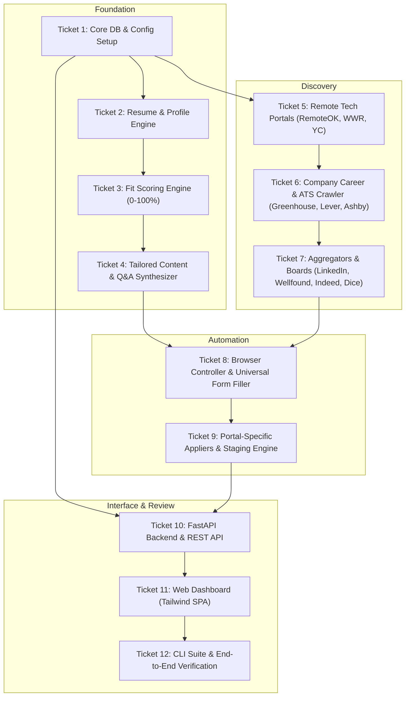

# HuntFlow: Roadmap & Ticket Tracking

## Overall Architecture Flow

---

## Ticket Progress Board

| Ticket | Description | Status | Verification Tests |
| :--- | :--- | :---: | :--- |
| **Ticket 1** | Project Foundation, Database Models & Configuration Setup | ✅ Completed | `tests/test_database.py` (4 passed) |
| **Ticket 2** | Candidate Profile & Resume Ingestion Engine (PDF/DOCX) | ✅ Completed | `tests/test_profile_manager.py` (7 passed) |
| **Ticket 3** | Semantic Fit Scoring & Match Engine (0–100%) | ✅ Completed | `tests/test_matcher.py` (9 passed) |
| **Ticket 4** | Tailored Content & Screening Q&A Synthesizer | ✅ Completed | `tests/test_generator.py` (9 passed) |
| **Ticket 5** | Job Discovery Engine: Remote Tech Portals (RemoteOK, WWR, YC Startup) | ✅ Completed | `tests/test_remote_portals.py` (6 passed) |
| **Ticket 6** | Official Company Career Page & Direct ATS Crawler (Greenhouse, Lever, Ashby) | ⏳ **Next Up** | `tests/test_company_crawler.py` |
| **Ticket 7** | Aggregator & Board Searchers (LinkedIn, Wellfound, Indeed, Dice) | 📋 Pending | `tests/test_searchers.py` |
| **Ticket 8** | Browser Controller & Universal Form Filler | 📋 Pending | `tests/test_form_filler.py` |
| **Ticket 9** | Portal-Specific Appliers & Staging Engine (HITL) | 📋 Pending | `tests/test_appliers.py` |
| **Ticket 10** | FastAPI Backend & REST API | 📋 Pending | `tests/test_api.py` |
| **Ticket 11** | Modern Web Dashboard UI (Tailwind SPA) | 📋 Pending | Manual / Browser |
| **Ticket 12** | Unified CLI Suite & End-to-End Verification | 📋 Pending | `tests/test_e2e.py` |

---

## Detailed Ticket Breakdown

### ✅ [Ticket 1] Project Foundation, Database Models & Configuration Setup
- **Deliverables**:
  - `pyproject.toml`, `requirements.txt`
  - `config.yaml`, `profile.example.yaml`, `companies.yaml`
  - `huntflow/config.py` (Pydantic Settings loader)
  - `huntflow/core/database.py` (SQLAlchemy models: `Job`, `Company`, `Application`, `ProfileSetting`, SQLite SessionManager)
  - `tests/test_database.py`

---

### ✅ [Ticket 2] Candidate Profile & Resume Ingestion Engine
- **Deliverables**:
  - `huntflow/core/profile_manager.py`:
    - `ResumeParser`: PDF (`pypdf`), DOCX (`python-docx`), text parsing.
    - `COMMON_SKILLS_CATALOG`: Regex boundary catalog matching.
    - `CandidateProfile`: Pydantic schema validation for contact info, preferences, skills, and Q&A.
  - `tests/test_profile_manager.py`

---

### ✅ [Ticket 3] Semantic Fit Scoring & Match Engine (0–100%)
- **Deliverables**:
  - `huntflow/core/matcher.py`:
    - Stage 1: Hard rule filters (company blacklist, title negative keywords, remote-only, salary floor).
    - Stage 2: Skill overlap detection (`matched_skills`, `missing_skills`).
    - Stage 3: Multi-factor composite fit scoring (0–100%) and pros/cons rationale generator.
    - Database updater `score_job(job, profile)`.
  - `tests/test_matcher.py`

---

### ✅ [Ticket 4] Tailored Content & Screening Q&A Synthesizer
- **Deliverables**:
  - `huntflow/core/generator.py`:
    - `CoverLetterGenerator`: Tailored 3-4 paragraph cover letter aligning candidate background, top matched skills, and past projects with job specs.
    - `PitchSynthesizer`: Concise, high-conversion 3-4 sentence pitch note (100-150 words) optimized for Wellfound / AngelList and direct startup outreach.
    - `QASynthesizer`: Screening Q&A resolver with exact & fuzzy string matching, rule-based heuristics for sponsorship, legal work authorization, notice period, salary, and skill-specific years of experience.
    - `stage_application_content`: Helper function connecting Job and Application database records with generated copy.
  - `tests/test_generator.py`: 9 comprehensive test cases verifying content tailoring and screening Q&A resolution.

---

### ✅ [Ticket 5] Job Discovery Engine: Remote Tech Portals
- **Deliverables**:
  - `huntflow/searchers/base.py`:
    - `JobPosting` schema with automatic SHA-256 ID generation and `.to_job_model()` conversion to SQLAlchemy `Job`.
    - `BaseSearcher` abstract base interface with robust HTML tag stripping and formatting utilities.
  - `huntflow/searchers/remote_portals.py`:
    - `RemoteOKSearcher`: Consumes RemoteOK's public JSON API with salary range and keyword matching.
    - `WeWorkRemotelySearcher`: Parses WWR XML/RSS feeds (`remote-programming-jobs.rss`) with title/company separation and category tagging.
    - `YCStartupSearcher`: Scrapes and standardizes Y Combinator and Hacker News "Who Is Hiring" startup job listings.
  - `huntflow/searchers/__init__.py`: Package entrypoint exporting all searchers.
  - `tests/test_remote_portals.py`: 6 unit tests with full network mocking and edge case coverage.

---

### 📋 [Ticket 6] Official Company Career Page & Direct ATS Crawler
- **Deliverables**:
  - `huntflow/searchers/company_crawler.py`:
    - Target Company Manager (loads and syncs `companies.yaml`).
    - Career URL Discovery & ATS Signature Detector (Greenhouse, Lever, Ashby, Workday).
    - Direct Job Parsers.
  - `tests/test_company_crawler.py`

---

### 📋 [Ticket 7] Aggregator & Board Searchers (LinkedIn, Wellfound, Indeed, Dice)
- **Deliverables**:
  - `huntflow/searchers/linkedin.py`, `wellfound.py`, `indeed.py`, `glassdoor_dice.py`.
  - `tests/test_searchers.py`

---

### 📋 [Ticket 8] Browser Controller & Universal Form Filler
- **Deliverables**:
  - `huntflow/automation/browser.py` (Selenium Chrome controller with persistent session, stealth flags).
  - `huntflow/automation/form_filler.py` (Heuristic field detector, dropdown/radio selector).
  - `tests/test_form_filler.py`

---

### 📋 [Ticket 9] Portal-Specific Appliers & Staging Engine
- **Deliverables**:
  - `huntflow/automation/linkedin_applier.py`, `wellfound_applier.py`, `indeed_applier.py`, `ats_applier.py`.
  - Staging Engine with human-in-the-loop review snapshots.
  - `tests/test_appliers.py`

---

### 📋 [Ticket 10] FastAPI Backend & REST API
- **Deliverables**:
  - `huntflow/web/app.py`: `/api/jobs`, `/api/search`, `/api/match`, `/api/stage/{id}`, `/api/approve/{id}`, `/api/profile`, `/api/companies`, `/api/analytics`.
  - `tests/test_api.py`

---

### 📋 [Ticket 11] Modern Web Dashboard UI (Tailwind SPA)
- **Deliverables**:
  - `huntflow/web/static/index.html` & `app.js`: Interactive UI for discovery, staging review queue, application tracker, company monitor.

---

### 📋 [Ticket 12] Unified CLI Suite & End-to-End Verification
- **Deliverables**:
  - `huntflow/cli.py` (Commands: `init`, `search`, `crawl-companies`, `match`, `review`, `serve`).
  - `tests/test_e2e.py`
  - Complete `README.md`.
