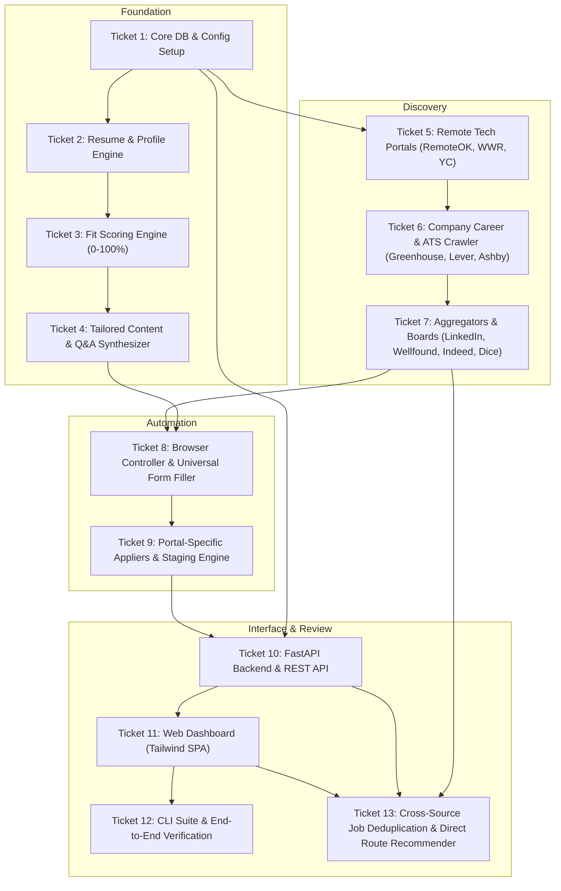

# Guffy: Roadmap & Ticket Tracking

## Overall Architecture Flow

---

## Ticket Progress Board

| Ticket | Description | Status | Verification Tests |
| :--- | :--- | :---: | :--- |
| **Ticket 1** | Project Foundation, Database Models & Configuration Setup | ✅ Completed | `tests/test_database.py` (4 passed) |
| **Ticket 2** | Candidate Profile & Resume Ingestion Engine (PDF/DOCX) | ✅ Completed | `tests/test_profile_manager.py` (7 passed) |
| **Ticket 3** | Semantic Fit Scoring & Match Engine (0–100%) | ✅ Completed | `tests/test_matcher.py` (9 passed) |
| **Ticket 4** | Tailored Content & Screening Q&A Synthesizer | ✅ Completed | `tests/test_generator.py` (9 passed) |
| **Ticket 5** | Job Discovery Engine: Remote Tech Portals (RemoteOK, WWR, YC Startup) | ✅ Completed | `tests/test_remote_portals.py` (6 passed) |
| **Ticket 6** | Official Company Career Page & Direct ATS Crawler (Greenhouse, Lever, Ashby) | ✅ Completed | `tests/test_company_crawler.py` (7 passed) |
| **Ticket 7** | Aggregator & Board Searchers (LinkedIn, Wellfound, Indeed, Dice) | ✅ Completed | `tests/test_searchers.py` (9 passed) |
| **Ticket 8** | Browser Controller & Universal Form Filler | ✅ Completed | `tests/test_form_filler.py` (4 passed) |
| **Ticket 9** | Portal-Specific Appliers & Staging Engine (HITL) | ✅ Completed | `tests/test_appliers.py` (9 passed) |
| **Ticket 10** | FastAPI Backend & REST API | ✅ Completed | `tests/test_api.py` (11 passed) |
| **Ticket 11** | Modern Web Dashboard UI (Tailwind SPA) | ✅ Completed | `tests/test_dashboard.py` (3 passed) |
| **Ticket 12** | Unified CLI Suite & End-to-End Verification | ✅ Completed | `tests/test_e2e.py` (7 passed) |
| **Ticket 13** | Cross-Source Job Deduplication & Direct Route Recommender | ✅ Completed | `tests/test_deduplication.py` (5 passed) |

---

## Detailed Ticket Breakdown

### ✅ [Ticket 1] Project Foundation, Database Models & Configuration Setup
- **Deliverables**:
  - `pyproject.toml`, `requirements.txt`
  - `config.yaml`, `profile.example.yaml`, `companies.yaml`
  - `guffy/config.py` (Pydantic Settings loader)
  - `guffy/core/database.py` (SQLAlchemy models: `Job`, `Company`, `Application`, `ProfileSetting`, SQLite SessionManager)
  - `tests/test_database.py`

---

### ✅ [Ticket 2] Candidate Profile & Resume Ingestion Engine
- **Deliverables**:
  - `guffy/core/profile_manager.py`:
    - `ResumeParser`: PDF (`pypdf`), DOCX (`python-docx`), text parsing.
    - `COMMON_SKILLS_CATALOG`: Regex boundary catalog matching.
    - `CandidateProfile`: Pydantic schema validation for contact info, preferences, skills, and Q&A.
  - `tests/test_profile_manager.py`

---

### ✅ [Ticket 3] Semantic Fit Scoring & Match Engine (0–100%)
- **Deliverables**:
  - `guffy/core/matcher.py`:
    - Stage 1: Hard rule filters (company blacklist, title negative keywords, remote-only, salary floor).
    - Stage 2: Skill overlap detection (`matched_skills`, `missing_skills`).
    - Stage 3: Multi-factor composite fit scoring (0–100%) and pros/cons rationale generator.
    - Database updater `score_job(job, profile)`.
  - `tests/test_matcher.py`

---

### ✅ [Ticket 4] Tailored Content & Screening Q&A Synthesizer
- **Deliverables**:
  - `guffy/core/generator.py`:
    - `CoverLetterGenerator`: Tailored 3-4 paragraph cover letter aligning candidate background, top matched skills, and past projects with job specs.
    - `PitchSynthesizer`: Concise, high-conversion 3-4 sentence pitch note (100-150 words) optimized for Wellfound / AngelList and direct startup outreach.
    - `QASynthesizer`: Screening Q&A resolver with exact & fuzzy string matching, rule-based heuristics for sponsorship, legal work authorization, notice period, salary, and skill-specific years of experience.
    - `stage_application_content`: Helper function connecting Job and Application database records with generated copy.
  - `tests/test_generator.py`: 9 comprehensive test cases verifying content tailoring and screening Q&A resolution.

---

### ✅ [Ticket 5] Job Discovery Engine: Remote Tech Portals
- **Deliverables**:
  - `guffy/searchers/base.py`:
    - `JobPosting` schema with automatic SHA-256 ID generation and `.to_job_model()` conversion to SQLAlchemy `Job`.
    - `BaseSearcher` abstract base interface with robust HTML tag stripping and formatting utilities.
  - `guffy/searchers/remote_portals.py`:
    - `RemoteOKSearcher`: Consumes RemoteOK's public JSON API with salary range and keyword matching.
    - `WeWorkRemotelySearcher`: Parses WWR XML/RSS feeds (`remote-programming-jobs.rss`) with title/company separation and category tagging.
    - `YCStartupSearcher`: Scrapes and standardizes Y Combinator and Hacker News "Who Is Hiring" startup job listings.
  - `guffy/searchers/__init__.py`: Package entrypoint exporting all searchers.
  - `tests/test_remote_portals.py`: 6 unit tests with full network mocking and edge case coverage.

---

### ✅ [Ticket 6] Official Company Career Page & Direct ATS Crawler
- **Deliverables**:
  - `guffy/searchers/company_crawler.py`:
    - `TargetCompanyManager`: Loads and syncs target companies from `companies.yaml` into SQLite.
    - `ATSSignatureDetector`: Regex and signature detection across Greenhouse, Lever, Ashby, Workday, SmartRecruiters.
    - `GreenhouseParser`: Direct Greenhouse boards API (`boards-api.greenhouse.io`) and HTML fallback scraper.
    - `LeverParser`: Lever postings JSON API (`api.lever.co/v0/postings`) and HTML fallback scraper.
    - `AshbyParser`: Ashby job board API (`api.ashbyhq.com/posting-api`) and HTML scraper.
    - `GenericCareerParser`: Pattern-matching fallback for bespoke company career sites.
    - `CompanyCrawler`: Batch crawl orchestration with keyword filtering, database deduplication, and active job counters.
  - `guffy/searchers/__init__.py`: Package export updates.
  - `tests/test_company_crawler.py`: 7 comprehensive unit and integration tests.

---

### ✅ [Ticket 7] Aggregator & Board Searchers (LinkedIn, Wellfound, Indeed, Dice)
- **Deliverables**:
  - `guffy/searchers/linkedin.py`: LinkedIn guest search endpoint client with Easy Apply tag detection, location/remote query filters, and salary parsing.
  - `guffy/searchers/wellfound.py`: Next.js hydration parser and HTML scraper for high-growth startups, equity/salary compensation, and quick pitch links.
  - `guffy/searchers/indeed.py`: Indeed search engine querying date-sorted listings, parsing mosaic data and `job_seen_beacon` cards, detecting 'Easily apply'.
  - `guffy/searchers/glassdoor_dice.py`:
    - `DiceSearcher`: Tech-specific searcher with API payload querying and HTML fallback.
    - `GlassdoorSearcher`: Glassdoor job listing extraction with Apollo cache parsing.
  - `guffy/searchers/__init__.py`: Package export updates.
  - `tests/test_searchers.py`: 9 comprehensive test cases verifying card extraction, JSON hydration, and network mocking across all searchers.

---

### ✅ [Ticket 8] Browser Controller & Universal Form Filler
- **Deliverables**:
  - `guffy/automation/browser.py`:
    - `BrowserController`: Selenium Chrome lifecycle management with persistent session profile (`--user-data-dir`).
    - Anti-detection flags (`--disable-blink-features=AutomationControlled`, removal of `navigator.webdriver` via CDP scripts, realistic user agent, window size).
    - `human_type`: Character-by-character typing with micro-randomized delays, smooth scrolling, and viewport screenshot capture.
  - `guffy/automation/form_filler.py`:
    - `FormFieldDetector`: Regex classification for 18+ field categories (contact info, profile URLs, file/resume, work authorization, sponsorship, notice period, compensation).
    - `UniversalFormFiller`: Bridges `CandidateProfile` and `QASynthesizer` into DOM form inputs, textareas, file upload controls, and dropdown options.
  - `guffy/automation/__init__.py`: Package export updates.
  - `tests/test_form_filler.py`: 4 unit tests verifying field classification, Chrome options, candidate value resolution, and DOM form filling.

---

### ✅ [Ticket 9] Portal-Specific Appliers & Staging Engine
- **Deliverables**:
  - `guffy/automation/ats_applier.py`: Direct ATS applier (Greenhouse, Lever, Ashby, Workday).
  - `guffy/automation/linkedin_applier.py`: LinkedIn Easy Apply multi-step modal applier with step progression and safety review halts.
  - `guffy/automation/wellfound_applier.py`: Wellfound apply drawer with custom startup pitch note insertion.
  - `guffy/automation/indeed_applier.py`: Indeed Quick Apply wizard handler.
  - `guffy/automation/staging_engine.py`: `ApplicationStagingEngine` orchestrating form filling, screenshot review snapshots, database staging, and 1-click human-in-the-loop submission approval.
  - `guffy/automation/__init__.py`: Package export updates.
  - `tests/test_appliers.py`: 9 comprehensive unit tests verifying staging, submit triggers, and state transitions.

---

### ✅ [Ticket 10] FastAPI Backend & REST API
- **Deliverables**:
  - `guffy/web/app.py`: High-performance FastAPI REST API endpoints:
    - `GET /api/jobs`: List and filter discovered jobs (by status, portal, company, min match score, pagination).
    - `GET /api/jobs/{id}`: Deep inspection of single job posting with linked staged application metadata.
    - `POST /api/search`: Multi-portal discovery trigger across 8 job portals (RemoteOK, WWR, YC, LinkedIn, Wellfound, Indeed, Dice, Glassdoor) with sync or background task modes.
    - `POST /api/crawl-companies`: Trigger target company career crawler across Greenhouse, Lever, Ashby, and bespoke career sites.
    - `POST /api/match`: Semantic fit match trigger scoring newly discovered or filtered jobs.
    - `POST /api/stage/{id}`: Human-in-the-Loop staging trigger invoking form autofill and screenshot capture without final submission.
    - `POST /api/approve/{id}`: 1-click execution for user-approved applications.
    - `GET /api/profile` & `PUT /api/profile`: Candidate profile inspection and YAML updates.
    - `POST /api/profile/resume`: Resume file ingestion (`.pdf`, `.docx`, `.txt`) with automated skill parsing and profile updates.
    - `GET /api/companies`, `POST /api/companies`, `DELETE /api/companies/{id}`: Target dream company tracking management.
    - `GET /api/analytics`: Application pipeline conversion funnel and portal distribution metrics.
  - `guffy/web/__init__.py`: Package export exposing FastAPI `app`.
  - `tests/test_api.py`: 11 comprehensive integration and unit tests covering all endpoints.

---

### ✅ [Ticket 11] Modern Web Dashboard UI (Tailwind SPA)
- **Deliverables**:
  - `guffy/web/static/index.html`: Responsive Tailwind CSS Single-Page Application dashboard with dark mode UI, multi-tab layout, filter toolbar, HITL review queue cards, company management modal, profile/screening configurator, and analytics conversion funnel.
  - `guffy/web/static/app.js`: Client-side single-page application engine featuring real-time state management, API health monitoring, debounced filtering, human-in-the-loop 1-click submit workflows, resume file upload handler, and modal controllers.
  - `guffy/web/app.py`: Static files mount at `/static` and root dashboard serving route (`GET /`).
  - `tests/test_dashboard.py`: Verification tests for UI asset presence, layout structures, and JS interaction hooks (3 passed).

---

### ✅ [Ticket 12] Unified CLI Suite & End-to-End Verification
- **Deliverables**:
  - `guffy/cli.py`: Unified Rich terminal command-line interface providing commands:
    - `guffy init`: Workspace, configuration file, and SQLite schema initialization.
    - `guffy search`: Cross-portal discovery querying with keyword and remote filters.
    - `guffy crawl-companies`: Targeted ATS crawling across dream organizations.
    - `guffy match`: Semantic composite fit scoring with summary match highlights table.
    - `guffy review`: Interactive terminal human-in-the-loop review queue for staged applications.
    - `guffy status`: Application pipeline conversion metrics and tracked company summary.
    - `guffy serve`: FastAPI REST API and Tailwind CSS SPA dashboard server launcher.
  - `tests/test_e2e.py`: 7 comprehensive End-to-End system verification tests covering CLI parser definitions, workspace setup, discovery ingestion, semantic fit scoring, and review queue handling.
  - `README.md`: Complete documentation covering architectural workflow, features, CLI commands, web dashboard guide, API reference, and installation instructions.

---

### ✅ [Ticket 13] Cross-Source Job Deduplication & Direct Route Recommender
- **Goal**: Consolidate identical job postings from multiple sources (Direct ATS, LinkedIn, Indeed, RemoteOK, etc.) under a unified canonical listing, display all available application outlets, and advise the candidate on the closest/most direct route to apply.
- **Deliverables**:
  - `guffy/core/database.py`:
    - Added `canonical_id` index and `is_canonical_primary` on `Job`.
    - Added `JobOutlet` model tracking `job_id`, `portal`, `job_url`, `directness_score`, `easy_apply`, and discovery timestamp.
  - `guffy/searchers/base.py`:
    - Title & company normalization engine (`normalize_company`, `normalize_title`, `compute_canonical_id`).
    - Directness scoring hierarchy: Direct Company ATS (Rank 100) > Direct Easy Apply (Rank 80) > Job Boards (Rank 60) > Syndicated Aggregators (Rank 40).
    - `save_or_link_posting` algorithm linking duplicate postings as alternate outlets and auto-upgrading primary posting attributes to the highest-directness source.
  - Ingestion updates in `guffy/cli.py`, `guffy/searchers/company_crawler.py`, and `guffy/web/app.py`:
    - Connected discovery pipelines to `save_or_link_posting`.
  - `guffy/web/app.py`:
    - Exposed outlets array, outlets count, and `recommended_outlet` in `/api/jobs` and `/api/jobs/{id}`.
  - `guffy/web/static/index.html` & `app.js`:
    - Multi-outlet badges on job cards and an interactive outlet picker dialog showing the direct route recommendation with one-click application choice.
  - `tests/test_deduplication.py`: 5 comprehensive unit & API integration tests covering normalization, multi-outlet linking, directness ranking, and API serialization (5 passed).
